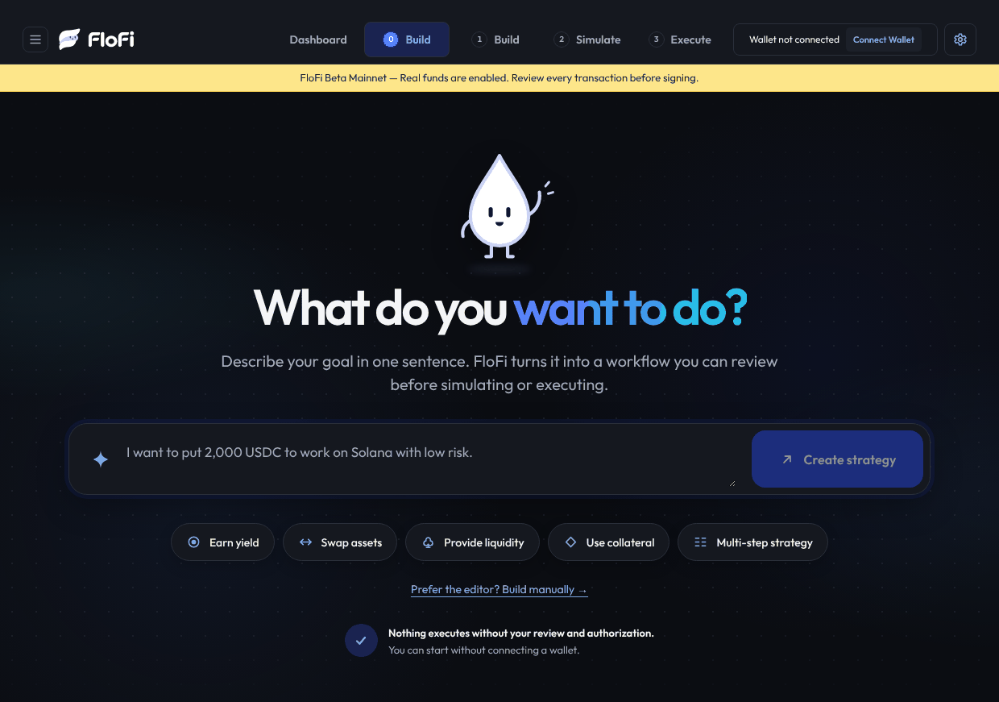

<p align="center">
  
</p>

<h1 align="center">FloFi</h1>

<p align="center"><strong>Many ways in. One clear path.</strong><br />
Describe a DeFi goal and execute it with your own wallet. Build DeFi workflows into your product with FloFi for Developers.</p>

<p align="center">
  <a href="https://flofi.xyz"><strong>Open FloFi</strong></a> ·
  <a href="https://flofi.xyz/docs">Docs</a> ·
  <a href="https://flofi.xyz/developers">FloFi for Developers</a> ·
  <a href="https://x.com/FloFi_xyz">X</a> ·
  <a href="https://discord.gg/36rEhdUa">Discord</a> ·
  <a href="https://www.linkedin.com/company/flofixyz/home/">LinkedIn</a>
</p>

<p align="center">
  
</p>

> **FloFi is in public beta on mainnet.** Workflows use real funds. Every transaction is simulated and shown to you before your wallet asks you to sign it, but on-chain actions carry market, protocol and smart-contract risk. Start small.

---

## FloFi for users

FloFi is a non-custodial DeFi platform. Describe a goal in chat, such as swapping USDC to ETH on Base or bridging an asset and using it in a later step. FloFi turns your request into a workflow, simulates the supported steps and shows the financial review. You choose whether to sign with your own wallet and can follow the outcome in FloFi. The visual Canvas is optional.

## FloFi for Developers

Use FloFi as the workflow layer for a wallet, fintech, protocol, app or AI agent. Your backend defines the DeFi intent and sends the user to a hosted FloFi review. FloFi composes the workflow, works with the registered protocols, prompts the user's wallet and reconciles the outcome. Your integration can read the status and evidence the user chooses to share.

`Create Project → API Key → Build Workflow → Simulate → User Authorization → Execute → Results`

The account-based Developer Console is release-gated. The existing Developer API sandbox is available to integrations on configured engineering deployments. Public self-service live keys and the external mainnet API journey are pending release. The hosted FloFi app supports mainnet and records confirmed and reconciled `PUBLIC_MAINNET` executions.

## How the workflow infrastructure works

1. FloFi composes an intent into a versioned strategy and computes the canonical workflow hash.
2. The shared capability registry and runtime check the requested actions, networks and protocols. Simulation previews the relevant flow.
3. A hosted approval binds the exact strategy revision to an expiring request. The user sees networks, assets, amounts, permissions, providers and fees in a fresh review.
4. The user's wallet authorizes the applicable transactions. Compatible steps can share a confirmation where the wallet and execution path support a batch. Other steps require separate confirmation.
5. FloFi observes submissions, reconciles individual steps and records evidence with its actual provenance. The requester can receive results within the user's sharing choice.

## Networks and operations

FloFi Web resolves eligible actions and protocol paths on five mainnets. A deployment, an asset, a wallet or an unavailable provider can further limit the paths it offers. Check discovery and review for the action you plan to use.

| Network | Swap | Bridge | Transfer | Lend & borrow | Add liquidity |
| --- | --- | --- | --- | --- | --- |
| **Ethereum** | Uniswap v3 | ✓ | ✓ | Aave V3 registered reserves | Uniswap v3 |
| **Base** | Uniswap v3 | ✓ | ✓ | Aave V3 registered reserves | Uniswap v3 |
| **Arbitrum One** | Uniswap v3 | ✓ | ✓ | Aave V3 registered reserves | Uniswap v3 |
| **Robinhood Chain** | Uniswap v3, including stock tokens | ✓ | ✓ | — | Uniswap v3 |
| **Solana** | Jupiter | ✓ | SOL and SPL tokens | — | Orca Whirlpools (SOL/USDC) |

**Bridges** connect any of the five networks — including EVM ↔ Solana — through FloFi's cross-chain router, which shows the provider, its fees and the guaranteed minimum you receive before you sign. Supported assets differ per network and protocol; the app offers only the combinations it can execute and explains anything it refuses.

**Multi-step workflows.** Chain eligible actions together, such as bridging and then swapping what arrived. Compatible steps can share a wallet confirmation when the wallet and network support a batch. Sequential flows present each applicable confirmation after the preceding step settles. A supported dependent step can spend what the previous step actually delivered within the reviewed limits.

## API, SDK, MCP and integrations

- The **Developer API v1** provides capability discovery, strategies, read-only previews, hosted approvals, consented execution reads and signed webhooks. [API guide](https://flofi.xyz/docs/developer-api) · [OpenAPI and reference](docs/developer/API.md)
- The **TypeScript SDK** wraps these endpoints for server-side integrations and verifies webhook signatures. Its versioned package can be built and packed from the repository. Registry publication is pending. [SDK](packages/developer-sdk/README.md) · [Webhooks](docs/developer/WEBHOOKS.md)
- **MCP** gives OAuth-enabled clients access to FloFi workflows and approval handoffs. **Telegram** has channel-specific access. Availability follows each deployment's configuration. [MCP](docs/deploy/MCP.md) · [Telegram](docs/deploy/TELEGRAM.md)

## Get started as a developer

Open FloFi for Developers and use the Developer Console on a deployment where project management is enabled. The existing sandbox quickstart shows how to provision a key on a local engineering deployment and run a complete server integration. Store the API key exclusively in your backend's secret manager. [FloFi for Developers](https://flofi.xyz/developers) · [Developer Console source](apps/reference-dapp/src/app/developers/console/page.tsx) · [Quickstart](docs/developer/QUICKSTART.md)

Install the [versioned SDK tarball](packages/developer-sdk/README.md) in your Node.js or Next.js project. This example uses a configured engineering deployment. Set `FLOFI_BASE_URL`, `FLOFI_API_KEY` and the test wallet's public `FLOFI_SIMULATION_SUBJECT` in your backend environment. FloFi uses the development subject only for the preview. Send `approvalUrl` to the user for wallet authorization and retain `approval.id` on the backend to fetch status.

```ts
import { FloFi } from '@defi-workflow-engine/developer-sdk';

const flofi = new FloFi({
  apiKey: process.env.FLOFI_API_KEY!,
  baseUrl: process.env.FLOFI_BASE_URL!,
});
const { data } = await flofi.capabilities.list({ action: 'bridge' });
const row = data.find(({ operations }) =>
  operations.compose.available && operations.simulate.available && operations.approve.available
);
if (!row) throw new Error('Bridge unavailable on this deployment');

const strategy = await flofi.strategies.create({ strategy: row.exampleStrategy });
const validation = await flofi.strategies.validate(strategy.id);
if (!validation.availability.approvable) throw new Error(validation.availability.reason ?? 'Review blocked');
await flofi.strategies.simulate(strategy.id, { simulationSubject: process.env.FLOFI_SIMULATION_SUBJECT! });
const approval = await flofi.approvals.create({ strategy });
// Give approval.approvalUrl to the user. Retrieve status with flofi.approvals.get(approval.id).
```

## Security and authorization

- **Non-custodial.** FloFi never stores your private keys or recovery phrase and never asks for them.
- **Your wallet is the only authority.** AI proposals, chat messages, MCP tools and API keys cannot authorize or move funds.
- **Review before signing.** Execution needs a fresh simulation, an explicit review of the Strategy Manifest and your wallet's signature. Material edits or expired quotes send you back to review.
- **Fail closed.** Unsupported combinations, mismatched wallets or networks, expired artifacts and unexpected results stop the workflow instead of guessing.
- **Evidence you can inspect.** Results are reconciled against what you approved and recorded with their real evidence level — never upgraded.

Simulation is a preview, not a guarantee of price or outcome. Open-source code and automated tests are not a security audit, and FloFi does not claim one. Read the [security model](docs/SECURITY_MODEL.md) and the [authority matrix](docs/AUTHORITY_MATRIX.md).

The review itemizes network and provider fees. Collection of the planned FloFi fee on completed workflows remains deferred.

## Repository architecture

| Path | Responsibility |
| --- | --- |
| `apps/reference-dapp` | FloFi Web, accounts, approvals, Developer API, MCP, protocol/runtime adapters and operational services |
| `packages/workflow-contracts` and `packages/action-registry` | Workflow types, validation contracts and registered capabilities |
| `packages/reference-compiler`, `reference-linter`, `reference-executor` and `reference-reconciler` | Compilation, policy checks, execution and evidence verification |
| `packages/cloud-runtime` | PostgreSQL state, migrations, leases and runtime persistence |
| `packages/developer-sdk` | Typed server client and webhook verification |

## Documentation

| | |
| --- | --- |
| [FloFi Docs](https://flofi.xyz/docs) | Getting started, your first workflow, networks, simulation, review, wallet authorization |
| [Developer docs](docs/developer/README.md) | API, SDK, webhooks, OpenAPI |
| [MCP](docs/deploy/MCP.md) · [Telegram](docs/deploy/TELEGRAM.md) · [WhatsApp](docs/deploy/WHATSAPP.md) | Connecting AI clients and channels |
| [Product specification](docs/specs/MASTER_SPEC_V3.2.md) | Product model and intended scope |
| [Security model](docs/SECURITY_MODEL.md) · [Authority matrix](docs/AUTHORITY_MATRIX.md) | Who can do what |
| [Deployment guides](docs/deploy) | Operating a FloFi deployment |
| [Engineering history](docs/builds/README-ENGINEERING-HISTORY.md) | The previous, build-oriented README |

### Run FloFi locally

Requires **Node 24.21.0** and **pnpm 11.22.0** (pinned).

```bash
git clone https://github.com/FloFi-xyz/FloFi.git
cd FloFi
pnpm install --frozen-lockfile --ignore-scripts
pnpm build
pnpm --filter @defi-workflow-engine/reference-dapp dev
```

Open `http://127.0.0.1:3000` for the landing page, `/app` for the builder and `/docs` for the documentation. A plain local run lets you author workflows without a wallet, with every execution flow off: quotes, simulation, accounts, channels and execution each need their documented configuration ([environment reference](docs/deploy/ENVIRONMENT.md)). Test networks are available only on a local engineering server (`FLOFI_NETWORK_SCOPE=ENGINEERING_TESTNETS`). Some runtime settings keep their legacy `GRYLOO_*` names for compatibility.

```bash
pnpm check                              # typecheck, lint, build, schema drift, unit tests
python3 scripts/governance_lite.py      # repository safety checks
```

Browser, PostgreSQL and fork suites need extra local tooling; see the [certification guide](docs/engineering/CI.md).

## Contributing

Contributions follow [GOVERNANCE-LITE](docs/SCOPE_GUARD.md): branch → change → tests → pull request → CI → maintainer review and merge. Keep wallet authority, fail-closed checks, evidence levels, dependency integrity and attribution intact, and say in your PR what you did not test. Questions and bugs: [GitHub issues](https://github.com/FloFi-xyz/FloFi/issues).

## License

FloFi is multi-licensed. Workflow contracts, the action registry, the Developer SDK and eligible documentation are **Apache-2.0**; the reference app and the reference linter, compiler, executor and reconciler are **AGPL-3.0-only**. See [LICENSE](LICENSE), the [license map](docs/LICENSE_MAP.md), [NOTICE](NOTICE) and [THIRD_PARTY_NOTICES.md](THIRD_PARTY_NOTICES.md). The FloFi name and marks are not licensed by the source licenses; see [TRADEMARKS.md](TRADEMARKS.md).

FloFi was formerly named Gryloo. Historical records and some runtime identifiers keep that name ([brand ADR](docs/adr/ADR-0006-flofi-product-brand.md)).
