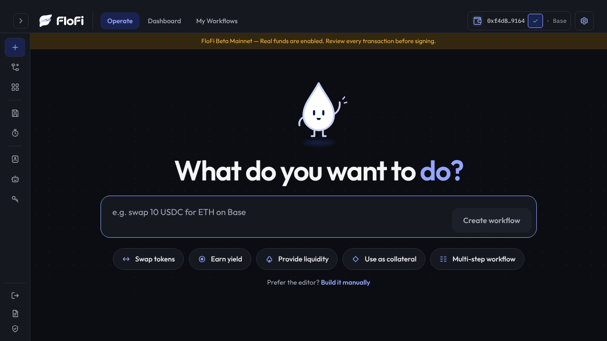

# BUILD-FLOFI-BETA-UX-INTELLIGENCE-001 — Wallet onboarding, address access, quote latency and workflow propagation

**Status:** ready for owner review. Nothing is merged, deployed or configured; no production database, credential, public provider or
real-money transaction was touched. Origin: real beta-tester feedback.

| Item | Value |
| --- | --- |
| Repository | `FloFi-xyz/FloFi` |
| Base | `origin/main` `78c8c981d1ed801eeaaf0e089ffe109c1a855ac2` (PR #248 merged, BUILD-FLOFI-UNIVERSAL-CHANNELS-001) |
| Branch | `claude/beta-ux-intelligence-001` |
| PR / tested SHA | see §12 |
| Parallel builds | MCP / Telegram work (BUILD-FLOFI-UNIVERSAL-CHANNELS-001) was already merged into this base; no other active branch was modified. No MCP, channel or developer-API contract changed in this build. |
| Database migration | none |
| Infrastructure change | none (Vercel, Railway `flofi-api` / `flofi-worker`, Neon unchanged) |

## Workstream status

| Workstream | Priority | Status | Why not COMPLETE (when applicable) |
| --- | --- | --- | --- |
| WS01 Automatic Privy wallet initialization | P0 | **COMPLETE (engineering evidence)** | Unit-tested and browser-verified end to end against the MOCKED loopback Privy (§10b). Real Privy (Google/email/Apple) on a preview remains to be validated (§13); not claimed. |
| WS02 Wallet address accessibility | P1 | **PARTIAL** | Header, Credentials and Review rows copy the full address (browser-verified in the header, §10b); the Editor's destination-wallet field and the Dashboard positions selector keep their existing displays (Dashboard portfolio already had Copy). |
| WS03 Editor quote performance | P1 | **COMPLETE (FloFi-controlled tail)** | One measured FloFi-controlled tail removed with before/after evidence under controlled conditions; production median/p95 need real-traffic measurement (§7, §13). |
| WS04 Universal workflow propagation | P0 | **PARTIAL** | Authoring-side inference, explicit-connect proposals and per-card provenance for every action, using the existing execution binding. Not browser-verified here; actual-above-estimate settlements are intentionally capped (§5). |

The statuses are deliberately conservative: code compiling and unit tests passing are not treated as completion of a user journey.

## 1. Root causes

### WS01 — "No wallet connected" after Privy email sign-in

Verified in source, not assumed:

1. **No automatic provisioning.** `floFiPrivyConfig` sets `embeddedWallets.{ethereum,solana}.createOnLogin: 'off'`, and the only code that
   created embedded wallets was the explicit *Create wallet* click on `/onboarding/wallets` (`components/account/add-wallets.tsx`), which the person
   can skip ("Skip for now", "Connect an existing wallet instead"). A new email/Google account that skipped it simply had no wallet.
2. **Product pages never recovered or provisioned.** `/app` only registered the wallets FloFi's server already listed (`wallet/flofi-wallet-sync.ts`
   → `floFiWalletInfo`). The server-side recovery `syncPrivyWallets` ran only on the onboarding page, so a wallet whose save never finished was
   recovered only there; Credentials then let the person connect/create.
3. **No initialization state.** The header (`components/top-bar.tsx`) had only *restoring* (from the wallet-hint cookie, absent for a first visit)
   or *Wallet not connected*, so a signed-in browser whose Privy SDK was still loading, or whose wallets were being read, was told it had none.

Not the cause: provider mounting (Privy mounts on `/app`, `signer-pages.ts`), session restoration (FloFi's HttpOnly session survives refresh), or
the auto-connect itself (`AccountWalletAutoConnect` connects a registered FloFi wallet correctly once one exists).

### WS02 — truncated, non-copyable addresses

The header slot, Credentials wallet rows and the Review wallet row rendered `0x1234…7890` as plain text (`top-bar.tsx`,
`secondary-product-workspace.tsx`, `review-workspace.tsx`). Only `/onboarding/wallets` and the Dashboard portfolio details offered Copy.

### WS03 — slow swap values in the Editor

The client already had (BUILD-FLOFI-EXECUTION-PERFORMANCE-001 and earlier, all reused, see §2): a per-node normalized quote snapshot (other cards'
edits do not re-quote), 200 ms debounce, in-flight request sharing, an expiry-bound answer cache, a latest-request-wins generation guard and
journey metrics. The remaining FloFi-controlled tail was on the server (`server/build-estimate.ts` `usdOf`): the optional USD price observation
started alongside the quote, but its **2.5 s wait timer started only after the quote returned**, so a slower price source delayed every catalog /
Jupiter estimate by up to 2.5 s after the token quote itself was ready.

### WS04 — Bridge does not inherit from Swap

1. `editor-history.ts` seeded a newly added card from the previous step's output through `followOnSelection` — **except Bridge**
   (`action.action !== 'bridge'`), and never seeded an amount.
2. An explicit Canvas connection (`CONNECT`) between two existing cards created an ordering dependency only and proposed nothing.
3. The execution side was already correct: `workflow-sequence.ts` funds a step from the latest earlier step delivering exactly its spending
   asset, simulates it only after that step reconciled, spends `min(authored cap, delivered)` and allocates deliveries so they are never spent
   twice. The defect was purely that the person had to re-enter the network, asset and amount for that funding to apply.

## 2. Previous implementation discovered and reused

| Need | Reused |
| --- | --- |
| Server-side wallet recovery | `account-service.ts` `syncPrivyWallets` / `saveEmbedded` (verified Privy token, own linked Privy user, never moves another account's address) |
| Wallet registration and connection | `wallet/flofi-wallet-sync.ts` `syncFloFiWallets`, `state/account-wallet-autoconnect.tsx` (unchanged rules: remembered/single wallet, Disconnect marks, never replaces an external wallet) |
| Wallet creation | `FloFiPrivy.createWallet` (Privy SDK, keys in Privy's frame) and its `PRIVY_WALLET_LIMIT` mapping |
| Copy feedback copy | existing catalog messages (`Copy {0}`, `{0} copied.`, `Copy unavailable.`) |
| Quote dedup / staleness | `state/build-estimate.ts` (`quoteSnapshot`, `sharedEstimate`, generation guard, `answered` cache) and its tests |
| Follow-on inference | `crypto-action-picker.ts` `followOnSelection` (extracted `followOnSelectionFrom`) |
| Output / funding semantics | `workflow-sequence.ts` `stepAssets`, `workflowSequence`, `boundAmount`, `fundingAllocations` |
| Card funding note | the lending card's existing "Funded by step N" note (generalized to every action) |
| Drafts and Apply | the Editor's existing `cryptoSelections` / `bridgeNetworkInputs` / `amountInputs` drafts |

## 3. Files and architecture changed

| Workstream | Files |
| --- | --- |
| WS01 | `state/account-wallet-lifecycle.ts` (new: planner, single-flight runner, per-user lifecycle store, header slot mapping), `state/account-wallet-provisioner.tsx` (new: mount + hook), `components/product-workspace.tsx` (mount beside the auto-connect, same exclusions), `components/top-bar.tsx` (slot states), `accounts/account-service.ts` (`PrivyWalletSync.method`, additive), `accounts/privy-client.tsx` (comment) |
| WS02 | `components/wallet-address.tsx` (new), `top-bar.tsx`, `secondary-product-workspace.tsx`, `review-workspace.tsx`, `app/ux-refinement.css` |
| WS03 | `server/build-estimate.ts` (`USD_AFTER_QUOTE_MS`, observation-relative budget), `server/build-estimate-latency.test.ts` (new benchmark) |
| WS04 | `domain/workflow-propagation.ts` (new), `domain/editor-history.ts`, `domain/crypto-action-picker.ts`, `components/workflow-canvas.tsx`, `components/composer-card.tsx`, `state/workflow-store.tsx`, `state/build-estimate.ts` (`knownLiveEstimate`, read-only) |
| Shared | `i18n/pt-beta-ux-intelligence.ts` (new) + `i18n/pt.ts`, `docs/engineering/coverage.json` + `COVERAGE.md` (new sources and suites mapped) |

All paths above are under `apps/reference-dapp/src/` except the docs.

## 4. Wallet lifecycle — before and after

| Moment | Before | After |
| --- | --- | --- |
| New email/Google user, skips onboarding wallets | No wallet anywhere; header "Wallet not connected" until Credentials / Add wallets | `/app` reads the account, creates one EVM and one Solana embedded wallet (one per ecosystem with none), saves them, registers them, auto-connect connects; header "Setting up your wallet…" meanwhile |
| Returning user | Wallets restored if the save had finished at sign-in | Same addresses, re-synced from Privy's API on the first product page; nothing created |
| Save interrupted (closed tab, timeout) | Recovered only on `/onboarding/wallets` | Recovered on any product page |
| External wallet login (MetaMask/Phantom) | Unchanged | Unchanged: never provisioned, only synced |
| Privy SDK still loading, signed in | "Wallet not connected" | "Setting up your wallet…"; after 20 s without Privy, a failure with Try again (reload) |
| Provisioning/sync failure | n/a | "Your wallet couldn't be set up." + Try again (re-reads, provisions what is still missing) |
| Account switch / logout | n/a | Lifecycle keyed by Privy user; a switch discards the previous run's result; logout resets to signed-out |
| Signed-out visitor | "Wallet not connected" | Unchanged |

Unchanged boundaries: no signature, session signer, delegated action or authorization key; `showWalletUIs: true`; Privy holds keys; every
transaction still needs simulation, FloFi Review and the person's confirmation in Privy's screen. The lifecycle is off inside embedding frames,
on `/approve` and `/mcp/approve`, and in engineering certification (same exclusions as the auto-connect).

Policy change for owner review: wallets are now created without a click for managed logins (Google, Apple, email). This is what the brief asks
("automatically discover or provision"); it remains one wallet per ecosystem, only when the account holds none of that ecosystem (an imported,
legacy or linked external wallet counts), and never for external-wallet logins.

## 5. Workflow propagation and dependency behavior

- **Output of a step** (`reusableOutput`): Swap, Bridge (to the owner), catalog/Jupiter swaps, Withdraw and Borrow deliver a spendable asset. Supply
  (receipt), Repay (debt reduction), Transfer, vault deposit and liquidity positions (position ids, two-token removals) deliver nothing a single later
  input can bind to; a Bridge/Transfer to an explicit recipient delivers to someone else.
- **Adding a card after a step**: Swap/Send/Aave/Pool cards keep `followOnSelection`; **Bridge now follows too** (`bridgeFollowOn`: source network and
  spending asset of the upstream output, symbol only when it resolves back to the same asset; the received asset is named too, and the destination
  follows the picker's Base-first order within the same ecosystem; an asset without a default route keeps the card's defaults). When the new card spends exactly that output, its amount starts from the upstream card's live estimate (`knownLiveEstimate`,
  read-only cache; truncated to the asset's decimals).
- **Connecting two existing cards**: when the consumer is connected but spends another asset/network, has no draft of its own and is not already
  funded by the runtime, FloFi proposes the network, asset and amount **as the card's ordinary draft**, and says so. A proposed draft never applies
  on a timer: only Enter, Apply or leaving the edited field applies it. Without a live estimate the amount is left empty (never the old number in
  the new asset's units); native outputs, Pools, Borrow and Withdraw never get an inherited amount. A later Chat command on that step drops the
  draft. A card being edited, a card already funded, or
  an ambiguous/unsupported case is left as is with a plain-language reason. Nothing is applied silently; applying re-validates through the card's
  own command and invalidates its quote and any simulation/Review exactly as a manual edit does (new snapshot, new revision).
- **Provenance on every card**: "Uses what step N delivers, up to this card's amount." when the sequence runtime funds it (`sequence.fundedBy`, the runtime's
  own truth), otherwise the mismatch reason (other asset, other network, no reusable output, other recipient, Aave draw).
- **Execution (unchanged)**: the dependent step is simulated only after the upstream step reconciled; it spends `min(authored cap, delivered)`
  (estimated 0.030 WETH, settled 0.0298 → 0.0298 is bridged; unprovable delivery → the step does not run); deliveries are allocated so two
  consumers never spend the same output; executed steps are never repeated (`validCompletions`); each step keeps its own Review and signature.
  An actual settlement **above** the estimate leaves the surplus in the owner's wallet: FloFi never spends more than the cap the person saw.
- **Parity**: nothing new is written into the canonical IR. Provenance is derived from `dependencies` + exact asset identity, so a workflow authored
  in Chat, the Editor, MCP or a channel reads the same. MCP/Telegram contracts are untouched.
- **Removal**: deleting/disconnecting the upstream card removes the dependency; the downstream card keeps its own visible authored values and its
  provenance note disappears (no hidden inherited state remains).

## 6. Action compatibility matrix (authoring inference; execution funding is the sequence runtime's)

| Producer → Consumer | Inference | Notes |
| --- | --- | --- |
| Swap → Bridge | network + asset + amount | new in this build |
| Swap → Swap / Send / Supply / Repay | network + asset (+ amount) | `followOnSelection` (+ amount new) |
| Bridge → Swap / Send / Supply | destination network + asset (+ amount) | including Base/Arbitrum/Ethereum/Robinhood/Solana per registry |
| Bridge → Bridge | network + asset (+ received asset) | source = previous destination |
| EVM ↔ Solana bridge → Solana/EVM step | destination ecosystem asset | destination wallet resolution unchanged (`destination-wallets.ts`) |
| Withdraw / Borrow → Bridge | network + asset | other consumers: funded by the runtime when the reserve matches, no pre-fill (§13) |
| Anything → Borrow / Withdraw | none | draws from Aave; reported as such |
| Supply / Repay / Send / vault / liquidity → anything | none | explained on the card |
| Swap → Pool | network + one side | two-sided amounts stay explicit |
| Multi-output / ambiguous terminal | none | explicit selection required |

## 7. Quote performance — before and after

Controlled engineering benchmark (`server/build-estimate-latency.test.ts`): MOCKED loopback Arbitrum chain and catalog, provider delay 80–160 ms
(one round trip), verified price source delay 1.2–1.6 s, 12 samples, same machine and conditions; before = the same test against the base file.

| Scenario | Before median / p95 | After median / p95 |
| --- | --- | --- |
| Price source slower than the quote | 1304 ms / 1505 ms | 424 ms / 465 ms |
| Price source answers in time (40–90 ms) | USD present | USD present 6/6, median 153 ms |

FloFi-controlled vs provider latency: in the after case ≈ provider time + ≤ 300 ms post-quote grace; the before case added up to 2.5 s of
FloFi-controlled wait. These are local engineering measurements, not production latency; production median/p95 should be read from the existing
journey metrics (`scripts/journey-latency-report.mjs`) after deployment. No quote, price or amount is fabricated: USD stays optional and is
dropped, never invented, when it is late.

Already-present guarantees verified by existing tests (`state/build-estimate.test.ts`): one request for equivalent unchanged inputs, typing
coalesced, unrelated card edits never re-quote, an older answer never overwrites a newer amount, expired estimates shown as expired.

## 8. Screenshots

MOCKED loopback evidence only (the auth-wallets suite's Privy stand-in, disposable database; generated keys, no real identity or funds):

`/app` right after "Skip for now": the header shows the automatically provisioned wallet (`0xf4d8…9164 · Base`) and its copy control in the
copied state — no Credentials visit. Editor propagation (WS04) and mobile/PT renders were not captured in this session (§13).

## 9. Specialist review evidence

Procedure: `agent_guard.py check` (PASS after mapping the new sources), `agent_guard.py impact --base origin/main` (all 19 domains selected because
`coverage.json` changed; primary owners: flofi-workflow, flofi-security, flofi-wallet-execution, flofi-frontend-ux), `agent_evolution.py`.
Specialists are the repository's read-only `.claude/agents/flofi-*.md` reviewers, at most three at once, each given the base, HEAD, changed paths,
its `agent_guard.py domain` contract and selected skills. Their reports are advisory, not certification.

### Batch 1 (HEAD `a98ef40`)

| Specialist | Result | Findings and resolution |
| --- | --- | --- |
| flofi-security | 4 findings, highest low | (1) an in-flight run could create a wallet under a newly switched Privy session → liveness check before every side effect; (2) cross-tab duplicate creation relied only on Privy → Web Lock per Privy user; (3) forced wallet sync could join a stale read → forced read chains a fresh one; (4) `ACCOUNTS_UNAVAILABLE` shown as signed-out → failure with Try again. All fixed in `1eb3904`, with tests. Confirmed: server enforces identity isolation independently (cookie session + linked Privy user); returning `method` leaks nothing new; WS04 drafts do not change execution authority. |
| flofi-wallet-execution | 12 findings, highest high (M1) | M1 endless "Setting up" (no step timeouts; Try again joined a hung run; `/approve` showed "Setting up" with the provisioner off; Connect Wallet hidden on failure) → bounded steps, Try again replaces the run, slot shows "initializing" only when the provisioner runs, Connect Wallet kept on failure. M2 = security (1). m1 = security (3). m2 brief false "not connected" while auto-connect connects → slot stays "setting up" while busy. m3 outage/mismatch → fixed / "Sign in again". m4 wallet held by another account → reported once, nothing created. m5 creation before Privy wallet readiness: not changed (a failure is recoverable with Try again; Privy SDK internals not verifiable offline). m6 policy change → flagged for the owner (§4). Nits: user wallet names no longer pass through the catalog; header shows a visible Solana tag. |
| flofi-workflow | 9 findings, highest high | (1) a proposed draft on a connected Swap/Bridge card auto-applied after the 1.2 s pause → proposed drafts never auto-apply (Enter/Apply required); (2) Bridge path kept the old number in the new asset's units when no estimate → amount cleared; (3) proposal could drop funding the runtime already gives a card → skipped when `sequence.fundedBy` is set; (4) wording overclaimed → "Spends up to its amount from what step N actually delivers", and no claim while a draft changes the asset; (5) Borrow/Withdraw took an inherited amount → excluded; (6) Pool on connect → excluded; (7) multi-parent check used the first parent → per-pair `pairProvenance`; (8) estimate-as-draft is an owner policy change → documented; (9) latency bound flakiness → bound relaxed to 1.1 s (old tail ≥ 1.2 s in every sample). All fixed in `1eb3904`. Confirmed: Chat/Editor/MCP/channel parity (nothing new in the IR), CONNECT→EDIT ordering safe, invalidation by revision, `knownLiveEstimate` read-only. |

### Batch 2 (HEAD `1eb3904`)

| Specialist | Result | Findings and resolution |
| --- | --- | --- |
| flofi-frontend-ux | 11 findings, highest medium | Raw `{0}` in connection feedback → step number substituted (catalog template keeps PT); copy-failure fallback vanished after 2 s (WCAG 2.2.1) → kept until the next attempt; new `{0} address` key became a broad PT template → exact EVM/Solana keys; copy labels named the wallet with broken PT grammar → "Copy EVM address" / "Copy <name> address"; button and live region inside the Credentials `h3` → address moved beside the heading; duplicate live regions → card note is static text; "Filled … amount" when no amount → two messages; wording/pt-BR tone. Not changed: focus after Try again (minor), duplicate `title` attributes (nit). Noted: a pre-existing catalog template turns "Treasury address" into "Treasury addres s" on `main` too (out of scope; owner follow-up). |
| flofi-swap | 5 findings, highest low | Cold price source now drops USD for that estimate (display-only, accepted; wording follow-up); proposal from a committed snapshot while the producer shows a draft → skipped; native outputs proposed the whole delivery (gas) → no inherited amount for native assets; reducer could pair an amount with another tail → `inheritedFrom` check; benchmark timing → bound relaxed, owner to decide its stage. Confirmed: no fabricated quote, no $1 stablecoin assumption, dedup/staleness guards unchanged, `knownLiveEstimate` read-only. |
| flofi-bridge | 8 findings, highest high | Input-only seeded universal draft could throw in render (`defaultUniversalOutput`) and showed a different pair than Apply → seeded networks always include `outputAsset`, else the card keeps its defaults; Arbitrum outputs defaulted to Robinhood Chain → picker's Base-first order; a connected universal card kept a stale/foreign output → proposal sets the output explicitly; testnet destination kept → only mainnet bridge networks. Not changed: bridge follow-on issues are silent (the card keeps its defaults; minor). Confirmed: certified Router stays for USDC Base→Arbitrum, Solana destination wallet resolution unchanged, settlement/recovery unchanged. |

### Batch 3 (HEAD `5d775c7`)

| Specialist | Result | Findings and resolution |
| --- | --- | --- |
| flofi-chat | 4 findings, highest medium | A direct Chat commit on a step kept a connection-proposed draft that a later Apply would use to overwrite the Chat's change → a non-Canvas command that changes a step drops that card's drafts (the card's own settings edits keep their amount draft, as an existing test requires); mismatch wording implied a mistake on Chat auto-links → "Runs after step N with its own asset…"; "never applies by itself" overstated → comment corrected (Enter, Apply or leaving an edited field are the person's gestures). Parity gap kept as a limitation (§13): the Chat does not yet pre-fill a Bridge from the previous swap. Confirmed: Chat and Editor get the same dependencies and card notes; pending proposals are retired by the drafts. |
| flofi-lending | 5 findings, highest low | Supply → Borrow reported "no reusable output" → draws are reported first; mismatch note stayed while a draft fixed it → hidden while drafted; zero inherited amount accepted → rejected. Kept as limitations: Borrow/Withdraw outputs are not used to pre-fill the next card (IR declares no `asset-out`); a new Borrow after a native output opens blocked on reserve choice (pre-existing `followOnSelection` behavior). Confirmed: aTokens never treated as spendable, reserve identity exact, execution unchanged. |
| flofi-channels | 1 finding, low | A run started on `/app` could continue after a client-side navigation into `/approve` → turning the provisioner off cancels the run before its next side effect; the compact approval header ignores the lifecycle. Confirmed: no channel/MCP/Telegram file changed, none imports the changed modules, i18n only adds keys. |

### Batch 4 (HEAD `b7e2769`, runner profile)

| Specialist | Result | Findings and resolution |
| --- | --- | --- |
| flofi-infrastructure-ci | 2 findings, highest medium | The latency unit test's "p95" was the slowest of 12 runs including a cold first call → one discarded warm-up, and each run is asserted against its own price delay (the real before/after difference), wall-clock figures printed only; the new journey was a runtime skip in the default profile and its own profile could pass with zero tests → the test is defined only in PUBLIC_MAINNET scope (default profile: 19 tests, no skip; a public run without its scope finds no test and fails). Confirmed: profiles run sequentially per shard/container (no port clash), fresh disposable database per profile, scope isolation, automatic shard placement, no ledger edit needed. `scripts/test_ci_gcp_orchestration.py` pins the profile count, updated 62 → 63 with the same comment convention as earlier builds. |

Not invoked (with reason): flofi-mcp, flofi-developers (no MCP tool schema, developer API or SDK contract changed; confirmed by flofi-channels'
import check); flofi-liquidity (positions are classified as non-reusable outputs only; no liquidity code changed); flofi-transfer-payments
(Send only receives inferred drafts through the shared picker); flofi-protocol-integrations (no catalog/RPC/provider adapter changed);
flofi-admin-analytics, flofi-automations, flofi-data-privacy, flofi-payments-billing (selected only because `coverage.json` changed; no source
in their domains changed, no migration, no deployment file changed).

`agent_guard.py review` reports each invoked specialist against the HEAD it reviewed; every later commit is a fix of the findings above (or, for
the last ones, of the infrastructure-ci findings), not new scope.

## 10. Automated tests and certification

| Gate | Result | Where |
| --- | --- | --- |
| `pnpm check` (typecheck, lint, build, schemas:check, unit) | **PASS** on `5d775c7`: 781 test files passed, 2 skipped; 10,083 tests passed, 2 skipped | local, Node **24.21.0** (official binary, SHA-256 verified), pnpm 11.22.0 |
| Focused suites after batch-3 fixes (`domain`, `state`, `components`, `i18n`, `wallet`, `editor`, excluding PG/fork/live as `pnpm test` does) | **PASS** on `55917fc`: 320 files, 4,283 tests | local |
| Typecheck + lint of changed files after batch-3 fixes | PASS on `55917fc` | local |
| `python3 scripts/governance_lite.py` | PASS | local |
| `python3 scripts/agent_guard.py check` | PASS (19 domains, 187 modules) | local |
| PostgreSQL: `accounts/account-service.pg.test.ts`, `accounts/wallet-service.pg.test.ts` | PASS 48/48 on **PostgreSQL 16.15** loopback (CI requires 18.6: supplementary only) | local |
| Browser: auth-wallets suite, default (engineering) scope | **19 passed** on build `55917fc` (run before the test became scope-defined it reported 19 passed + the new test skipped; it now lists 19 tests, none skipped) | local, pinned Chromium 1243, PG 16 loopback |
| Browser: new `auth-wallets-public` profile (PUBLIC_MAINNET scope) | **1 passed**: skip Add wallets → `/app` → 2 Privy creations, 0 signatures, both saved, header connected, Copy = full address, reload restores the same wallets | local |
| `python3 -m unittest discover -s scripts -p 'test_ci_*.py'`, `scripts/test_governance_lite.py` | 336 + 21 passed (after the 62 → 63 profile count) | local |
| CircleCI certification | runs on push; authoritative | PR checks |

New suites: `state/account-wallet-lifecycle.test.ts` (provisioning policy, liveness, cross-tab lock, bounded steps, account switch, approval
cancel), `components/wallet-address.test.tsx`, `domain/workflow-propagation.test.ts` (outputs, provenance, Bridge follow-on for several sources,
Canvas summary/inversion/label agreement, settled-vs-estimated binding, Chat-commit draft supersession, PT coverage),
`server/build-estimate-latency.test.ts` (WS03 benchmark). Updated for the intentional markup change: `components/product-shell.test.tsx`,
`components/secondary-product-workspace.test.tsx`. No test was deleted, skipped or weakened.

### 10b. Browser evidence notes

The account wallet lifecycle (and the pre-existing auto-connect) are off in engineering certification, which is the browser suites' default scope.
The new journey therefore runs in a dedicated runner profile, `auth-wallets-public` (`scripts/guarded-release-browser.mjs`, PUBLIC_MAINNET scope,
same MOCKED loopback harnesses). Playwright defines the test only for that scope. This follows the existing precedent for
public-scope journeys (`copilot-pool-dialogue`, `solana-mainnet-network`). First attempts failed for test reasons, fixed in the test: a click
before hydration (now waits for the page's readiness, as the other journeys do), the engineering scope (now its own profile), and the
renamed copy button.

### 10c. CircleCI browser follow-up

[Pipeline 600](https://app.circleci.com/workflow/badf2b25-43f9-4791-adbb-495c2068a3be) on `0a9350df` passed 11 jobs and failed browser shards 2 and 8.
The workflow acceptance tests now select the save confirmation in the Workflow workspace. The Credentials tests check the heading and address
separately, use both copy controls, and check the workspace's rename and removal messages. The Canvas test checks the proposed network and
asset, the empty draft amount, and the single committed revision. The two swap-authoring screenshots changed only around the new header Copy
control. The first uses CircleCI's render, which matched the pinned Chromium render locally pixel for pixel. The second uses the local render,
with the same header change.

Local follow-up checks passed `pnpm check` (10,087 unit tests passed, two skipped), governance and CI script tests (21 and 336 passed), the
account and wallet suites (48 passed on PostgreSQL 18.6), the workflow acceptance profile (six passed), the three affected shard 2 specs
with strict screenshot comparisons (16 passed), and the offline fork gate. CircleCI's final `certification` job for the PR head records
the certification verdict.

## 11. Security considerations

- Identity isolation: the lifecycle is keyed by Privy user id and discards results of a run started for another user; the server action still
  derives the account from the HttpOnly session and refuses a Privy user other than the account's linked one.
- `method` returned to the browser is the browser's own session's sign-in method (no other account's data).
- No key, phrase or credential is displayed or copied: `WalletAddress` handles public addresses only.
- Execution authority unchanged: drafts are never applied silently; amounts stay bounded by the reviewed cap.

## 12. PR, tested SHA and deployment readiness

- PR: [FloFi-xyz/FloFi#249](https://github.com/FloFi-xyz/FloFi/pull/249), from `claude/beta-ux-intelligence-001` against `main`.
- Tested SHA: full `pnpm check` on `5d775c7`; focused suites, typecheck and lint on `55917fc` (batch-3 fixes); CircleCI runs on the pushed head.
- Deployment readiness: no migration, no environment variable, no infrastructure change. Vercel (web), Railway `flofi-api` / `flofi-worker`
  and Neon need no action beyond the normal deploy of this code. Do not merge before owner review and CircleCI certification.

## 13. Remaining limitations (need real-user or authorized validation)

- Real Privy Google/email/Apple sign-in with automatic creation, on a preview with a test Privy app; two tabs signing in at once.
- Browser journeys not yet automated: header failure/initializing states, copy on mobile and in Portuguese, Swap → Bridge → Supply authoring
  and connection proposals on the Canvas (unit-covered at the reducer/domain level only).
- Production quote latency distribution (journey metrics) after deployment.
- Actual-above-estimate settlement leaves surplus by design; a "use all of the upstream output" mode would need a reviewed change to the
  sequence binding and its authorization semantics.
- Chat parity: the Chat does not yet pre-fill a Bridge's network/asset from the previous swap ("bridge it to Arbitrum" still asks); the amount
  cannot come from an estimate in Chat by its grounding policy. The workflow itself (dependencies, provenance) is identical in Chat and Editor.
- Borrow/Withdraw outputs are not used to pre-fill the next card; a Bridge after them is. Native outputs (ETH, SOL) never get an inherited
  amount (gas headroom); the person enters it.
- Privy SDK details not verifiable offline: whether `createWallet` waits for its wallet frame, and the exact "already has a wallet" error text
  for both chains (mapped to `PRIVY_WALLET_LIMIT`). A failure is recoverable with Try again; real Privy validation on a preview is required.
- A pre-existing catalog template rewrites "Treasury address" as "Treasury addres s" in Portuguese (also on `main`): owner follow-up.
- A cold USD price source now omits the USD figure for that estimate instead of delaying the token quote (display-only).
- The WS03 benchmark uses real timers; it now asserts each run against its own price delay (≥ 700 ms of headroom) after a warm-up, but the
  owner may still prefer to move it out of the required unit stage.
- `scripts/ci-browser-timings.json` has no measurement for `auth-wallets-public` yet (the balancer treats it as a median profile); refresh after
  a few green certifications, as `docs/engineering/CI.md` describes.

## 14. Jira workstream references

No Jira project or issue keys were provided and no Jira connector is authorized in this session; workstreams are traced as WS01–WS04 in commits
and this document. The owner can attach the keys in the PR.
