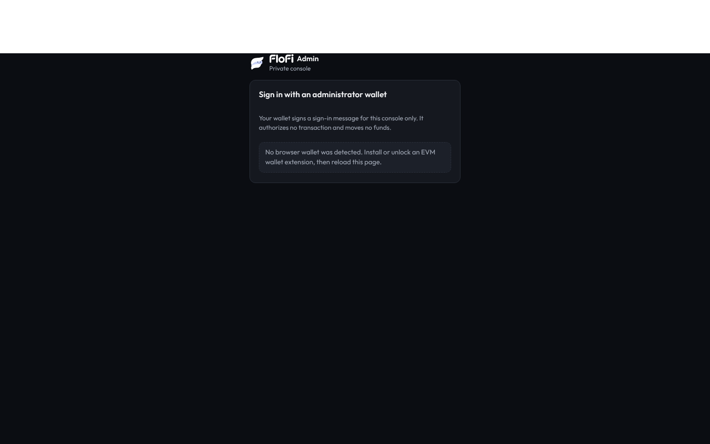
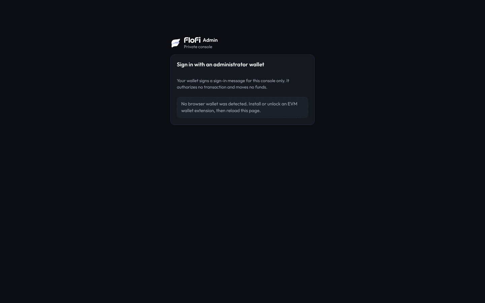

# BUILD-FLOFI-RECONCILIATION-PRIVACY-UX-001 — nonce-conflict reconciliation, Support privacy controls, Admin login fix

Status: implemented on a branch for owner review. **Not merged, not deployed.** No production database, log, RPC provider, Railway or Vercel
setting was read or changed, and no transaction was signed or sent. Every claim about the two incidents below is about what the records and the
code can and cannot establish; none is a verdict on their financial outcome.

| Workstream | Result |
| --- | --- |
| P0 nonce-conflict reconciliation | Read-only forensic investigation, durable diagnostics, RPC dedupe, stable-conflict pacing and operator escalation, Support display. Outcomes stay `SUBMISSION_RESULT_UNKNOWN` unless the flow's own reconciliation proves otherwise. |
| P1 Support privacy | Separate, governed text store (atomic with the audit skeleton); period-scoped lookup keys; legal holds; retention dry run and approval-gated enforcement (**inactive**); CLI data-subject procedure; privacy notice. Periods are **proposals** pending counsel. |
| P2 Admin login white strip | Root cause found (collapsed margin), fixed in Admin CSS only; reproduced and verified in a real browser, light/dark, desktop/mobile/short. |

Migration: **0027 `reconciliation_privacy` (additive)** with a Release A certificate — rollout in
[RELEASE-RECONCILIATION-PRIVACY-0027.md](../deploy/RELEASE-RECONCILIATION-PRIVACY-0027.md).

---

## 1. Discovery

- Base: `origin/main` at `6f4e065` (merge of PR #194, Support & Recovery). Branch `claude/peaceful-dijkstra-mdupk0`.
- Read: `AGENTS.md`, `CLAUDE.md`, `docs/SCOPE_GUARD.md`, `apps/reference-dapp/AGENTS.md`, `docs/engineering/coverage.json`,
  `docs/deploy/{ADMIN,SCHEMA-COMPATIBILITY,ENVIRONMENT}.md`, `docs/builds/BUILD-FLOFI-ADMIN-SUPPORT-RECOVERY-001.md` (§8.5, §9).
- Where the conflict is recorded: `router-service.ts` (`ROUTER_NONCE_CONSUMED_BY_DIFFERENT_TRANSACTION`), `universal-router/service.ts`
  (`UNIVERSAL_…`), `uniswap-liquidity-service.ts` (`UNISWAP_…`). All three use `discoverEvmNonce` / `sameEvmIntent`
  (`evm-submission-discovery.ts`) and store the consuming transaction's hash as `conflictingTransactionHash` on the attempt, in the run's
  durable log only (not in `execution_attempts`).
- Worker: `packages/cloud-runtime/src/worker.ts` retries with `backoffMs` (15 s doubling, capped at 10 min) until `MAX_DELIVERIES = 500` or
  7 days, then DEAD (`OBSERVATION_BUDGET_EXHAUSTED`) and `attention_required`. `backend/app.ts` `reconcile` handler observes under the run
  lease. `work-queue.ts` itself needed no change.

## 2. P0 — the two nonce incidents

### 2.1 Root cause (mechanism, from the code)

For an EVM attempt with no receipt, each observation runs `discoverEvmNonce`: if the account's nonce count at the head is above the reserved
nonce, it binary-searches `eth_getTransactionCount` from the prepared block to the head (≈ log₂(blocks) reads, ~20–23 on Base/Arbitrum after
two weeks) to find the block that consumed the nonce and the transaction in it. If `sameEvmIntent` (sender, chain, nonce, target, calldata,
value) does not match, the attempt becomes `SUBMISSION_RESULT_UNKNOWN` with `conflictingTransactionHash`, and the run keeps
`needsObservation`. Nothing in the flow can ever change that verdict for an approval step (there is no protocol deadline for approvals), so
every later observation repeated the same ~25 reads and the same answer until the budget ran out — 500 deliveries / up to 7 days, about 3.5
days at the 10-minute cap. That is the "useless repeated observation". The ambiguity itself is real: a consumed nonce proves only that the
transaction *at that nonce* is not a direct send of the reviewed call.

FloFi reserves a nonce per owner per flow namespace (`*_OWNER_NONCE_IN_USE`), not globally; independent workflows in other namespaces (and
external wallets) can use the same account nonce. That is by design and this build does not add a global reservation (it would block
independent workflows and cannot constrain external wallets anyway). Nonce competition between FloFi workflows of the same owner on the same
chain is therefore expected and is what both incidents show.

### 2.2 Incident A — `xuni-379461c2e3f1807a0dc0455342a51d21` (Base 8453, APPROVAL, nonce 60)

Facts given in the request (not re-read by this build): the reviewed call is a USDC approval to the universal router's spender for 1 USDC;
no hash was recorded for it; nonce 60 was consumed by `0x236d2c4f…139d4`, which `xroute-3e24d126e836528cecfb7dc445852c9b` recorded as *its*
confirmed approval (a different spender); that workflow's confirmed bridge deposit used nonce 61 (`0xa2938caa…6718`) and bridged USDC→USDC.

What can be established, once the investigation runs on final data (Resume transaction check — §6):
- whether `0x236d…` is a **direct** approval (`DIRECT`, not EIP-7702, sender without delegation code) whose calldata/Approval event names a
  **different spender** — then the reviewed approval is **absent from that transaction** (`reviewedEffectInConflict: ABSENT`);
- that `0x236d…` is linked to `xroute-3e24…` **by exact hash** (not by similarity of intent);
- whether the sender emitted any `Approval(owner, reviewedSpender)` from the prepared block to the final head under any other nonce
  (`alternateNonce`), and whether FloFi ever asked the wallet for a later step of this execution (`laterAttempts`).

What cannot be established, whatever the investigation finds: that the reviewed approval will never be broadcast later under another nonce
(a wallet may still hold a re-signed request); that the other workflow's bridge relates to this execution's intent (it does not, by identity;
its USDC→USDC deposit is never counted as evidence for this USDC→USDT execution). Therefore the outcome stays **UNKNOWN**. Bounded context
for the owner, not a verdict: an ERC-20 approval moves no tokens by itself, and if `laterAttempts` is empty FloFi never prepared a deposit for
this execution's order.

### 2.3 Incident B — `xroute-a09617c2bb8ac5469cab1fc955a3fd32` (Arbitrum One 42161, APPROVAL, nonce 29)

Facts given: reviewed USDC approval for a 5 USDC bridge to Base; no hash recorded; nonce 29 consumed by `0xd7c93de4…a223`, recorded by
`ars-1963ff046993f0d2098032a7` as its confirmed approval, followed by a swap at nonce 30. `xroute-d24ac723c2c4307b384c26a1abcb3b64` is an
earlier, reconciled bridge with similar economic intent but a distinct identity — **never** linked (the investigation links runs by exact
transaction hash only; a unit test asserts it is absent from the related workflows).

Chronology: the uncertain bridge was recorded on 28 October, the conflicting swap on 5 November. The investigation records the consuming
transaction's block; it does **not** infer that the later transaction "replaced" the original, and the report says so. Note: BUILD-FLOFI-ADMIN-
SUPPORT-RECOVERY-001 §8.5 (from an earlier snapshot) lists B as `ROUTER_TRANSACTION_NOT_OBSERVED`; this request reports
`ROUTER_NONCE_CONSUMED_BY_DIFFERENT_TRANSACTION`. This build read no production data and cannot say which is current; both keep the outcome
unknown and both are handled (the investigation runs only for the nonce-conflict code). Outcome: **UNKNOWN**, for the same reasons as A.

### 2.4 Reconciliation behaviour — before and after

| | Before | After |
| --- | --- | --- |
| Each observation of a recorded conflict | ~25 RPC reads per nonce discovery (the router discovers twice per observation) + the flow's own reads | **4 reads per discovery** (≈ 8 for the router): the recorded consumer is re-verified by hash (`eth_getTransactionByHash`, receipt, `finalized` head, canonical block hash, sender, nonce, block ≥ prepared). Anything not proven there runs the full search unchanged. |
| Forensic detail | the hash only, in the run log | `execution_nonce_conflicts`: classification, field-by-field comparison, structure (direct / EIP-7702 / delegated self-call / delegated account / contract creation), reviewed effect in the consuming receipt, alternate-nonce Approval scan (bounded, resumable cursor), peer FloFi runs by exact hash, `laterAttempts`, reasons, safe next action, evidence fingerprint, last independent verification |
| Cadence for unchanged evidence | 15 s → 10 min, until 500 deliveries / 7 days | approval steps: 15 min → 30 min → … ≤ 12 h; while a scan progresses 30 s. **Unchanged** (normal backoff): RPC failures, deposit and other non-approval steps (their evidence is the flow's own protocol scan), and any run with a later step that may be on the network. |
| End state | DEAD `OBSERVATION_BUDGET_EXHAUSTED` | after ≥ 4 unchanged, **complete** checks and ≥ 24 h since first investigated: DEAD `NONCE_CONFLICT_STABLE_OPERATOR_REVIEW` (attention flag; outcome still UNKNOWN). Non-approval steps are never "complete" here (their evidence is protocol-specific) and only back off. |
| Re-inspection | Resume transaction check | unchanged; the new code is explicitly allowed (exact-code exception; retry limit 3 / 7 days still applies). New evidence (different fingerprint) resets stability and re-opens automatic observation. |
| Financial verdict | flow's state machine | **unchanged** — the investigation is never fed into a flow and never writes a run, attempt, journal or evidence. |

Classes (`nonce-conflict.ts`): `MATCHING_TRANSACTION_CONFIRMED` (left for the flow to settle), `CONFLICTING_TRANSACTION_IDENTIFIED`,
`DELEGATED_EXECUTION_UNDETERMINED`, `POSSIBLE_ALTERNATE_NONCE`, `INSUFFICIENT_CHAIN_EVIDENCE`. There is deliberately **no
`PROVEN_NOT_EXECUTED`**: proof of non-execution stays the flows' own protocol verdicts (`*_SUBMISSION_EXPIRED_NOT_EXECUTED`). Note
(pre-existing, unchanged): for a **conflicted** deposit that verdict is unreachable today — the router proves expiry only while the nonce is
unconsumed and the universal router has no deadline branch — so such a run stays unknown until its budget ends; a protocol-based proof
with a consumed nonce (complete deposit scan past `depositMustLandBy`) is a possible follow-up, not part of this build. Every report has
`financialOutcome: 'UNKNOWN'`. Conservative rules: an EIP-7702 transaction, a call to the sender's own delegated code, or a delegated account
whose receipt might carry the reviewed effect is *undetermined*; a plain self-send from an account without code (a wallet cancel) is a direct
conflict; an RPC failure never replaces a stored complete report nor resets its stability; a consumer above the `finalized` head is not final
evidence; the RPC client must answer the attempt's own `eth_chainId`.

Read-only by construction: the investigator may call only `eth_chainId`, `eth_getBlockByNumber`, `eth_getTransactionByHash`,
`eth_getTransactionReceipt`, `eth_getCode`, `eth_getLogs` (enforced in code and tested), through the flow's observe-only transport
(`observeOnly` already refuses every send method). It runs after the run lease is released; before escalating, the run is re-read and the
investigated run must be unchanged (the whole conflicted subject, including later attempts); the decision is settled back under the run
lease, and a run that changed meanwhile is simply checked again at the normal cadence. Alternate-nonce candidates that another FloFi run
recorded (any nonce, same tenant and owner) are attributed to that run by exact hash. Delivery stays at-least-once: a worker that dies after
recording a check but before settling counts that check twice (escalation can come one check earlier; the 24 h floor still holds).

### 2.5 RPC cost (per conflicted run, approval step)

Before: ~25 reads × up to 500 deliveries ≈ 12 000 reads over ~3.5 days. After: one full scan of Approval logs from the prepared block to the
final head (2 000 blocks per `eth_getLogs`, ≤ 50 windows per check — one-time ≈ 370 calls for two weeks of Base, ≈ 2 900 for two weeks of
Arbitrum's faster blocks), then ~12 reads per check for ~6–8 checks before escalation. The scan window size is a constant (`SCAN_BLOCKS`); a
provider allowing larger `eth_getLogs` ranges could raise it later.

### 2.6 Admin Support integration

The run's *Diagnose* page gains **Nonce-conflict investigation** (`nonce-conflict-view.ts`): network, step, reserved nonce, the consuming hash
(marked *verified final on chain* only when it is), evidence source, related FloFi workflow (exact hash only), comparison table, structure,
reviewed effect, alternate-nonce result, later steps, proof completeness, last independent verification, check counts, why the outcome is
unknown, and the safe next action. Status reads *Investigation in progress*, *Investigation complete — outcome still unknown* or *… escalated
for operator review (outcome still unknown)* — never "resolved". The transaction outcome line is always *Unknown — this investigation never
decides the transaction outcome*. No wallet address is shown (the report stores none); explorer links are labelled *a link, not evidence*.
The lifecycle model, recovery registry, state tokens, idempotency, limits and audit are unchanged.

## 3. P1 — privacy data inventory and architecture

### 3.1 Inventory (Support & Recovery)

| Record | Where (since 0027) | Personal data | Retention (proposed) | Enforcement |
| --- | --- | --- | --- | --- |
| Audit skeleton (`SUPPORT_RECOVERY`, `SUPPORT_NOTE`, `SUPPORT_SEARCH`) | `admin_audit_events` (append-only, unchanged) | operator principal id; run/incident/operation ids (pseudonymous) | with the execution record, ≤ 5 years | none in this build (needs a separate, approved phase: partitioning) |
| Recovery reason / note text | `admin_support_texts` (separate; `textRef` + digest in the skeleton) | whatever an operator typed (screened; must not contain personal data) | 12 months | approval-gated `retention-apply`; legal holds |
| Lookup fingerprint | skeleton (`fingerprint`, `fpv: 2`, `period`, `kid`) + quarter key in `admin_lookup_keys` | pseudonymous (re-identifiable with key + candidate) | 12 months after the quarter | approval-gated key destruction; legal holds |
| Legacy text / v1 fingerprints (before 0027) | inline in `admin_audit_events` | as above | as above | **not removable by this build**; v1 fingerprints become unlinkable only by rotating `FLOFI_ADMIN_SESSION_SECRET` |
| Data-subject requests | `privacy_requests` | wallet as keyed fingerprint only; principal id | not set (counsel) | — |
| Legal holds, activations | `privacy_legal_holds`, `privacy_retention_activations` | none | permanent records (released / revoked, never deleted) | — |
| Nonce-conflict diagnostics | `execution_nonce_conflicts` | none (no address; tx hashes; run ids) | removed with the run (purge cascade) | — |

### 3.2 Architecture

- **Separate text, atomically** (`privacy.ts` `writeSupportText`): the text row and the audit event are written in one transaction (note: a new
  transaction in `support-http.ts`; reason: inside the existing serialized recovery transaction). The skeleton keeps `textRef`/`reasonRef` and
  `textDigest`/`reasonDigest` = HMAC-SHA-256(body) under a random 32-byte salt stored with (and deleted with) the body — integrity is
  verifiable while the text exists and unlinkable after. Bodies are immutable (trigger); a correction is a new note. Reading tolerates removal:
  *Text removed under the retention policy or an approved erasure request*.
- **Period-scoped lookup keys**: one random 32-byte key per calendar quarter, AES-256-GCM-wrapped (12-byte IV, AAD = tenant | quarter | key id)
  under `HKDF(admin key, 'flofi/admin-lookup-kek/v1')`; `kid` = first 16 hex of SHA-256 of that wrapping key (identifies a rotation, reveals
  nothing). Destruction sets the wrapped bytes to NULL and keeps the row (`RETENTION_EXPIRED`); a destroyed key cannot be revived or deleted
  (trigger). If the key cannot be read, the lookup is refused and audited (`SUPPORT_SEARCH_UNAVAILABLE`) — never an unaudited lookup. Backups:
  a destroyed key remains in database backups until their window passes, and the wrapping secret lives in Vercel; both are documented.
- **Retention**: `retention-report` is a dry run (counts, `basis: PROPOSED_NOT_ACTIVE`, the legacy rows it cannot reach). `retention-apply`
  refuses without an ACTIVE `privacy_retention_activations` row (created by `retention-activate` with an approval reference; one per policy;
  revocable; never deleted). Texts are deleted when older than the **approved** period of the active activation (whatever period was
  configured when they were written; `expires_at` is the displayed schedule), never under a hold (enforced by SQL and by a trigger). Holds,
  retention and erasure are serialized per tenant (advisory lock), so a hold cannot race a deletion. `TRUNCATE` is refused on the privacy
  tables. Deploying the code deletes nothing.
- **Data-subject requests** (CLI only; there is no HTTP endpoint and no delete-all control): RECEIVED → APPROVED/REJECTED (with code and
  approval reference) → COMPLETED (with counts), enforced by trigger. Access recomputes the wallet's fingerprints under every live quarter key
  (and v1) and lists runs (counts), Support texts and matching lookups; erasure deletes unheld texts about the subject (execution runs,
  including purged ones via the purge audit; multi-step workflow runs; delegated executions; or texts they wrote as an administrator) and keeps the
  skeleton, execution records and fingerprints, and says so; correction/objection/restriction close with a recorded code.
- **Preserved**: VIEWER/OPERATOR, wallet sign-in, CSRF/same-origin, rate limits (still counted on audit events), tenant scoping on every new
  query (and tenant foreign keys), search authorization and the recovery rules.

### 3.3 Public privacy notice

`/privacy` (EN and PT) gains *Support, operator access and audit* (`#support-audit`): operator access to execution records for support, the
purpose of the access audit, the categories involved, the proposed periods (stated as under legal review and not enforced yet), the
candidate basis (legitimate interest), user rights and the existing verified contact (`flofi.xyz@gmail.com`). No certification is claimed
(tested), and LGPD art. 6 / art. 18 are not presented as lawful bases.

## 4. P2 — Admin login white strip

**Root cause.** `.admin-sign-in { margin: 12vh auto 0 }` is the first child of `.admin-root`, which (like `body`) has no padding, border or
own block formatting context, so that top margin **collapsed through `.admin-root` and `body`**: both started 12vh below the top, and the area
above showed the canvas, painted with the product's `body { background: #fff }` (base.css). In dark mode that is the white band in the
screenshot; in light mode a near-white band (#fff over #f8fafd). Hydration and theme logic were not involved. Measured before the fix: the
topmost pixel of every sampled column was painted by the bare canvas (white) at 1440×900, 390×844 and 1280×560, light and dark, both before
and after hydration.

**Fix (Admin CSS only, `src/app/admin/admin.css`):** `.admin-root { display: flow-root }` (keeps child margins inside the console; nothing else
in the layout changes), and `html:has(.admin-root), html:has(.admin-root) body` take the console page colour (light/dark), so overscroll or
any future gap never shows white. `base.css`, the product, routing, wallet sign-in, sessions and grants are untouched. The card, brand,
colours, typography, buttons and wallet choices are unchanged (same position — the 12vh offset is now painted).

**Verification:** `e2e/admin-login-layout.spec.ts` (6 cases: light/dark × 1440×900, 390×844, 1280×560) checks, before hydration and after it,
the element and colour painting the top row, real screenshot pixels decoded in the page, `.admin-root` top = 0 and height ≥ viewport, no
horizontal overflow, body background = console colour, no layout shift between first paint and hydration, brand above and aligned with the
card, no page errors and no off-origin request. It failed on the unfixed build (all 6) and passes after the fix; the existing admin-console
suite (sign-in with an injected wallet, sessions, CSRF, Support) passes unchanged in the same run.

| Before (dark, 1440×900) | After |
| --- | --- |
|  |  |

More: `before-light-desktop.png`, `before-dark-mobile.png`, `after-{light,dark}-{desktop,mobile}.png` in the same folder.

## 5. Legal review — proposed vs approved, and what is outstanding

### 5.1 Periods

| Record | Proposed (BUILD-FLOFI-ADMIN-SUPPORT-RECOVERY-001 §9) | Approved | Configured default |
| --- | --- | --- | --- |
| Reason / note text | 12 months | **none** | 365 days (`FLOFI_SUPPORT_TEXT_RETENTION_DAYS`) |
| Lookup fingerprints | 12 months | **none** | 365 days after the quarter (`FLOFI_SUPPORT_LOOKUP_RETENTION_DAYS`) |
| Recovery audit skeleton | with the execution record, ≤ 5 years | **none** | not enforced |

### 5.2 Outstanding for counsel (unchanged from §9 unless noted)

1. Lawful basis per record (LGPD art. 7 IX / VI / II; GDPR art. 6(1)(f) / (c)), the legitimate-interest balancing test (ANPD 2024 guidance),
   and whether the RIPD (LGPD art. 38) is required.
2. The periods above, including the 5-year skeleton cap (CDC art. 27; Código Civil arts. 205–206) and whether LGPD art. 16 supports keeping the
   skeleton after processing ends.
3. Whether the GDPR applies (art. 3(2)); international transfers (hosting regions; LGPD art. 33, ANPD Resolution 19/2024; GDPR Chapter V).
4. Backups: Neon point-in-time recovery keeps deleted text and destroyed keys for its window — acceptable or not, and how to disclose it.
5. The privacy-notice wording (now published as proposals, marked as under review) and the 15-day reply commitment for these requests.
6. The data-subject request format: whether the stored keyed subject fingerprint is enough, how identity is verified, and how much of the
   access output (operator ids, note text) is disclosed.
7. Whether and how to remove legacy inline text (pre-0027) — needs a separately approved structural change (options 3/4 of §9).

### 5.3 Activation requirements

Counsel's written approval of periods and bases → owner approval → `retention-report` dry run reviewed → holds placed for disputes →
`retention-activate` with the approval reference → `retention-apply`. Nothing in the deployment does any of this.

## 6. Migration, rollout, rollback

Migration 0027 is additive (six new tables; no change to any existing object or row). Certificate `{ base: 0026, migrations: [0027] }`
ships in a separate commit (**Release A**) so the deployed build keeps serving once 0027 is applied. Order: Release A to Railway API, worker and
Vercel → Release B: Railway API (pre-deploy migrates), worker, Vercel. No environment variable is required. Full steps, verification,
incident follow-up and the emergency reversal: [RELEASE-RECONCILIATION-PRIVACY-0027.md](../deploy/RELEASE-RECONCILIATION-PRIVACY-0027.md);
compatibility assessment: [SCHEMA-COMPATIBILITY.md §19](../deploy/SCHEMA-COMPATIBILITY.md#19-certificate-0027_reconciliation_privacy).

After deployment, Incidents A and B remain exactly as they are (their checks stopped; the sweeper does not re-arm flagged runs). To see their
investigation, an operator runs *Resume transaction check* on each (read-only; limit 3 per 7 days). Nothing resolves them automatically.

## 7. Tests and evidence

See §7.1 (filled from the final local run) and the PR for CI. Local environment: Node 24.21.0, pnpm 11.22.0, PostgreSQL **16.15** (CI uses
18.6), Foundry Anvil 1.8.3 (archive and binary digests verified against `scripts/bootstrap-anvil.py`), Chromium headless shell 1243.

### 7.1 Results (final local run, after the review fixes)

| Gate | Result |
| --- | --- |
| `pnpm check` (typecheck, lint, build, `schemas:check`, unit) | **pass** — 666 files, 8 044 tests passed, 2 skipped (the same 2 as on `main`) |
| `pnpm test:postgres` (PostgreSQL 16.15) | 835 passed, 3 skipped, **1 failed**: the PostgreSQL-18-specific 0015 catalog assertion, which fails identically on unmodified `origin/main` in a clean worktree (environmental, not this build) |
| New/changed PG suites: `nonce-conflict-cloud`, `privacy`, `support-http`, `reconciliation-privacy-migration`, `flight-gate-migration`, `support-recovery-cloud`, `crosschain-router-cloud`, `crosschain-universal-cloud` | pass |
| Guarded browser profile `admin-console` (`node scripts/guarded-release-browser.mjs profile admin-console`) | **9/9 pass** — 3 existing (sign-in with an injected wallet, sessions, CSRF, Support recovery) + 6 new layout cases; the 6 new cases fail on the unfixed build |
| `python3 scripts/governance_lite.py` + its unittest suite (21) | pass |
| `python3 scripts/agent_guard.py check` | PASS (new modules mapped in coverage.json) |
| `scripts/test_ci_optimization.py` (56) | pass |
| Release A commit on its own (clean worktree): forward-compatibility + migration-manifest unit tests, backend `schema-compatibility.pg` (v26 build on the 0027 fixture), flight-gate migration test, governance-lite | pass |

Not run locally: the remaining guarded browser profiles (product, composition, fork-backed financial suites) — this build changes no product
page except `/privacy` text (whose links and HTTP 200 are asserted there); fork (Anvil) suites — no contract or execution path changed.
CircleCI is the certification authority.

### 7.2 Coverage of the requested scenarios

| # | Scenario | Where |
| --- | --- | --- |
| 1, 2 | same wallet/network/nonce, different workflow; different spender (Incidents A and B) | `nonce-conflict.test.ts` |
| 3 | genuinely matching transaction | `nonce-conflict.test.ts` |
| 4, 11 | unreadable / unavailable data, every RPC method failing; chain mismatch; identity mismatch | `nonce-conflict.test.ts`; outage on PostgreSQL in `nonce-conflict-cloud.pg.test.ts` |
| 5, 6 | delegated self-call carrying the reviewed effect; EIP-7702 set-code; delegated account; plain cancel | `nonce-conflict.test.ts` |
| 7, 9 | reviewed approval under another nonce; approval without a later deposit | `nonce-conflict.test.ts` |
| 8, 10 | another workflow's bridge / fill never counted for this execution | `nonce-conflict.test.ts` |
| 12 | finality; bounded, resumable scan; stable fingerprint across a later head | `nonce-conflict.test.ts` |
| 13 | historic transaction found only after a retry | `nonce-conflict.test.ts` |
| 14 | stable conflict: pacing, escalation thresholds, never early for incomplete steps | `nonce-conflict.test.ts`; end-to-end in `nonce-conflict-cloud.pg.test.ts` |
| 15 | worker restart, idempotent single row, fast path (no binary search) | `nonce-conflict-cloud.pg.test.ts`, `evm-submission-discovery.test.ts` |
| 16 | multi-tenant isolation | `nonce-conflict-cloud.pg.test.ts`, `privacy.pg.test.ts`, `reconciliation-privacy-migration.pg.test.ts` |
| 17 | no false success / failure / non-execution | every class asserts `financialOutcome: 'UNKNOWN'`; run stays `PENDING` after escalation (cloud test) |
| 18 | no submission by any observer | allow-listed methods only; harness send counter unchanged; no send method in recorded calls |
| — | Support lifecycle regression; the new stop code's eligibility, exact exception, retry limit | `lifecycle.test.ts`, `support.test.ts`, `support-http.pg.test.ts`, `admin-console.spec.ts` |
| P1 | append-only skeleton; atomic writes; expiry without skeleton loss; period keys; destroyed / rotated keys; tenant isolation; holds; dry run; no purge without activation; no wallet / key / text leakage; DSR states | `privacy.pg.test.ts`, `support-http.pg.test.ts` |
| P1 | migration additive, v26 compatible by certificate, purge cascade, lock-timeout rollback | `reconciliation-privacy-migration.pg.test.ts`, `forward-compatibility.test.ts` |
| P2 | white strip absent, light/dark, desktop/mobile/short, before/after hydration; sign-in unchanged | `admin-login-layout.spec.ts`, `admin-console.spec.ts` |

## 8. Operational risk

- **Investigation cost**: bounded per check (≤ 50 `eth_getLogs` + a few reads); one-time initial scan per conflict (see §2.5). A provider
  refusing a 2 000-block range yields `INSUFFICIENT_CHAIN_EVIDENCE` and the previous cadence — never a verdict.
- **Escalation is a stop, not a verdict**: the run stays `SUBMISSION_RESULT_UNKNOWN`, flagged, high severity on mainnet; an operator must look.
  A delayed broadcast after escalation is not observed automatically until a resume (documented; the reason the threshold needs complete,
  unchanged evidence for 24 h).
- **Fast path**: only for a recorded consumer that re-verifies as canonical and final with the same sender and nonce; otherwise the unchanged
  full search runs. A reorg deeper than `finalized` is outside every flow's assumptions already.
- **Privacy**: a lost admin secret makes lookup keys unreadable (lookups refused until a new key is created under the new secret — automatic
  for the current quarter). Retention is inactive; mis-activation is guarded by an approval reference, a dry run, holds and audit.
- **Rollback window**: a Release A Admin does not list Release B notes and shows their reasons as "—" (display only); notes it writes meanwhile
  are inline again (outside the new controls).

## 9. Rollback

Application: redeploy Release A everywhere (serves schema 27 by certificate). Database: emergency reversal SQL in the release document (drops
only the six new tables and their functions; owner decision). Nothing in this build changes or deletes pre-existing data, so no data repair is
ever needed on rollback.

## 9b. Specialist reviews (advisory) and dispositions

Six read-only specialist reviews (wallet-execution, security, data-privacy, workflow, admin-analytics, bridge) found **nothing blocking**. Fixed:
deposit/non-approval steps and runs with an open later step keep the old cadence; amount-matching alternate-nonce candidates are never dropped
and truncation makes a report incomplete; chain id must match for a "match"; unverified same-nonce runs and scan progress no longer change the
fingerprint; the investigation client is always wrapped observe-only; settlement returns under the run lease with a full re-check; escalation is
recorded only after the stop succeeds; candidates recorded by another FloFi run are attributed; the fast path rejects a consumer in the prepared
block (as the full search does); erasure/access also cover purged runs, workflow-run and delegated-execution notes, without a row cap; the
approved period governs retention; holds, retention and erasure are serialized per tenant; TRUNCATE is refused on the privacy tables; a
request's decision code is frozen at completion; AES-GCM tag length enforced; lookup fingerprints are computed after the rate limit; the Support
section reflects the run's current check state and LEGACY text is labelled; privacy-notice wording corrected; CLI error text bounded.
Accepted as documented limitations: a delegation cleared within the consuming block is read at end of block (label only; approvals are still
protected by receipt logs); the retention gate is procedural (approval reference not verified by the database); the condition label
"observation exhausted" is reused for review stops (counts unaffected).

## 10. Known limitations

- No production record, log or RPC was read: the incident sections describe what the investigation will establish, not its result.
- Delegated / batched inner calls are detected, not decoded; attribution needs an operator with independent sources.
- Alternate-nonce search covers ERC-20 approvals (Approval events); other steps rely on the flows' protocol-specific scans and deadlines.
- Uniswap-liquidity records share the router/universal attempt shape, so their `UNISWAP_NONCE_CONSUMED_BY_DIFFERENT_TRANSACTION` conflicts get
  the fast path and the same investigation; that path is covered by the shared unit tests only (the cloud test uses the router flow). Solana
  flows are out of scope (no account nonces).
- Legacy (pre-0027) inline reasons/notes and v1 fingerprints cannot be removed by these controls.
- Retention periods and bases are proposals; enforcement has never run against production.
- PostgreSQL suites ran locally on 16.15; CI runs 18.6. One existing assertion (`forward-compatibility.pg.test.ts`, the 0015 NOT NULL
  catalog diff) is PostgreSQL-18-specific and fails on 16 — it fails identically on unmodified `origin/main` (verified in a clean worktree).
- The worker's stale-snapshot re-check (run changed during an investigation) is implemented but not exercised by a dedicated test.
